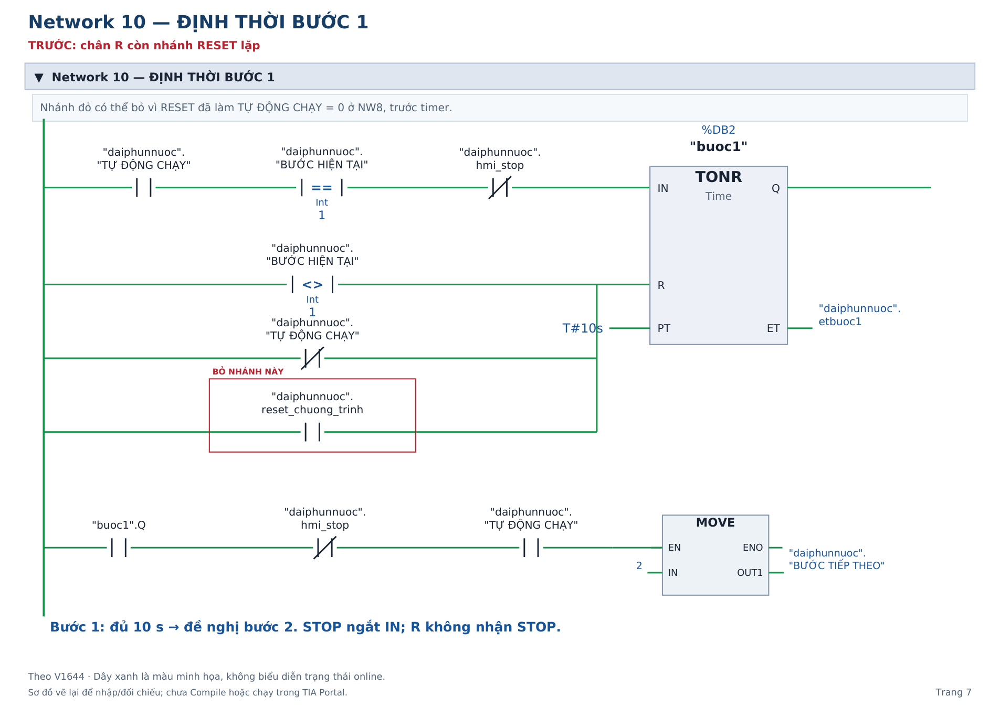
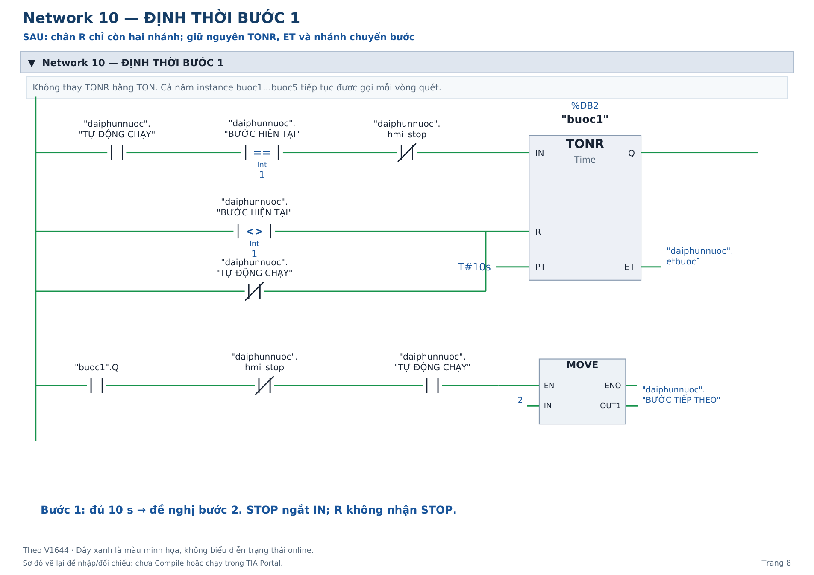

# Hướng dẫn sửa LAD V1644 bằng hình

Vẽ lại theo cách trình bày của PDF mẫu bạn gửi: tiếp điểm thường mở/thường đóng, cuộn thường/S/R, khối so sánh Int, TONR, MOVE, T_CONV, DIV, SUB, CONV và chân tín hiệu.

**Đây là 20 trang trước/sau của những phần cần chỉnh, không phải chương trình 20 Network.** Giữ số Network của bản V1644 gốc có 18 Network. Logic của PDF mẫu 12 Network không được chép sang bản này.

- [Mở/tải PDF đầy đủ](Huong_dan_sua_LAD_V1644_bang_hinh.pdf)
- [Tải HTML để mở trên máy, có sẵn toàn bộ hình](Xem_LAD_truc_quan.html)
- [Thư mục ảnh PNG và SVG từng trang](hinh)

**Cách đọc:** khung đỏ là nhánh cần bỏ; khung xanh là vị trí thay toán hạng hoặc tên biến. Trang TRƯỚC dùng đối chiếu, trang SAU dùng dựng lại. Không nhập cả hai phiên bản và không gọi cùng instance timer thêm lần nữa. Dây xanh là màu minh họa, không phải trạng thái online.

| Trang | Network gốc | Nội dung |
|---|---|---|
| 1–2 | NW1 | Trước/sau bỏ cuộn thường KHỞI TẠO CHỜ; giữ hai R và hai MOVE 0 |
| 3–4 | NW5 | Đổi tiếp điểm thường đóng KHỞI TẠO CHỜ thành FirstScan |
| 5–6 | NW7 | Đổi nhánh thường mở KHỞI TẠO CHỜ thành FirstScan; giữ nhánh RESET |
| 7–8 | NW10 | Timer bước 1 trước/sau bỏ nhánh RESET lặp tại chân R |
| 9–12 | NW11–14 | Vẽ đầy đủ bốn timer bước 2–5 sau sửa |
| 13–14 | NW15 | Hai MOVE 0 trước/sau bỏ nhánh RESET lặp; nhánh chốt bước giữ nguyên |
| 15 | Cuối NW16 | Chỉ xóa nhánh R KHỞI TẠO CHỜ, giữ các nhánh van và bơm |
| 16–17 | NW18 | Đổi giaydachay3 thành giay_con_lai_tinh tại SUB.OUT và CONV.IN |
| 18 | Cuối NW18 | Giữ nhánh ghi 0; hướng dẫn giữ phần sửa hiển thị nếu đã áp dụng bản 17 Network |
| 19 | NW17 | Giữ năm biến etbuoc1…5 và vẽ đủ các nhánh chọn thời gian |
| 20 | Phụ lục | Ví dụ ET trực tiếp để tham khảo; không áp dụng mặc định |

## Khi dựng lại trong TIA

1. Lưu bản sao project. Kiểm tra FirstScan %M1.0 được cấu hình đúng trong byte hệ thống %MB1.
2. Làm đủ các thay đổi NW1, NW5, NW7 và cuối NW16 cùng nhau. Kiểm tra Cross-references rồi mới xóa KHỞI TẠO CHỜ khỏi DB.
3. Bỏ năm nhánh reset_chuong_trinh tại chân R timer và hai nhánh tại MOVE 0 ở NW15. **Giữ reset_chuong_trinh tại NW7**; giữ NW7–8 trước timer.
4. Giữ năm TONR, PT T#10s, năm instance buoc1…buoc5 và các ET. Không đưa hmi_stop vào HỦY PHÉP CHẠY hoặc TỰ ĐỘNG CHẠY.
5. Đổi tên giaydachay3 thành giay_con_lai_tinh, kiểu DInt. Kiểm tra SUB.OUT và CONV.IN dùng tên mới; thoigianconlai vẫn Int, HMI_CONLAI vẫn liên kết biến này.
6. Nếu đã áp dụng phần ghi 0 giây cho bước ngoài 1–5 của bản đề xuất trước, giữ nó. Tài liệu này không yêu cầu bỏ phần sửa hiển thị đó.
7. Compile PLC/HMI rồi kiểm tra STOP/tiếp tục, RESET, lỗi và hết ca trong PLCSIM. Đây là bản vẽ lại từ ảnh, chưa được Compile/chạy trong Siemens.

Các tag HMI_TRONG_GIO, HMI_CA_SANG, HMI_CA_TOI, HMI_GIO_PLC vẫn giữ khi đối tượng HMI đang dùng. Chúng là liên kết hiển thị, không cần tạo thêm rung LAD để được coi là biến có công dụng.

## Xem nhanh ví dụ timer

Trước khi sửa — bỏ nhánh khoanh đỏ:

Sau khi sửa — chân R còn hai nhánh:

