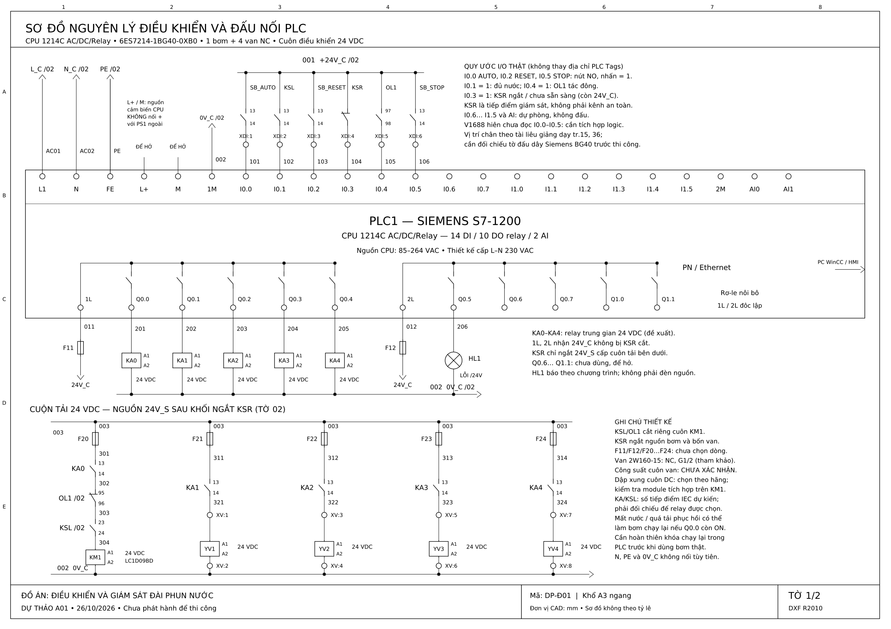
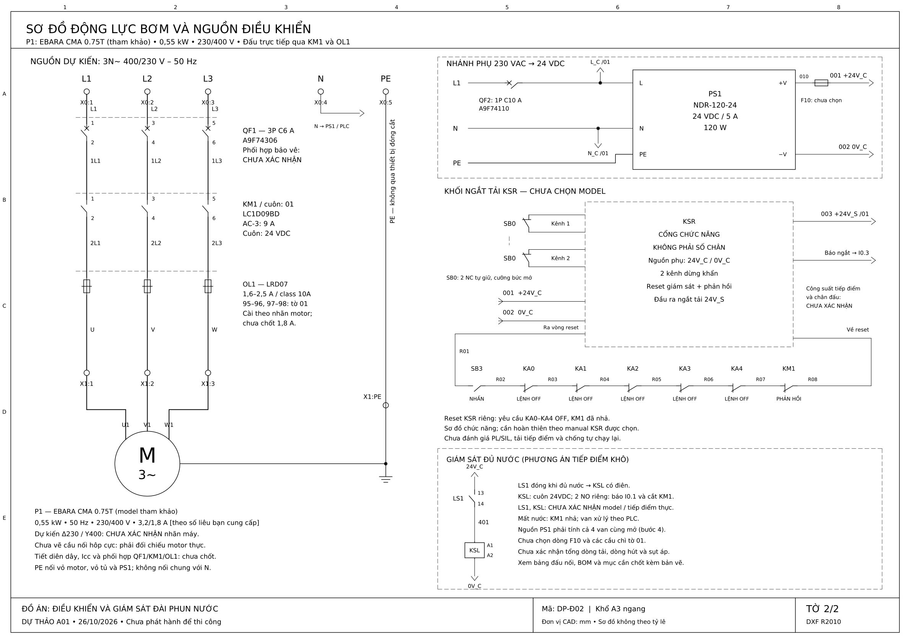

# Bản dự thảo sơ đồ điện đài phun nước — 26/10/2026

**Tải trọn bộ:** [So_do_dien_A3_DU_THAO_A01.zip](So_do_dien_A3_DU_THAO_A01.zip) · **Xem hai tờ:** [PDF A3](Hai_so_do_A3_DU_THAO_A01.pdf)

Bộ tài liệu gồm hai sơ đồ A3 ngang: **đấu nối PLC và điều khiển 24 VDC**; **động lực bơm ba pha và nguồn điều khiển**. Các tệp DXF có thể mở, sửa và lưu thành DWG trong AutoCAD/AutoCAD Electrical 2027. PDF và PNG dùng để xem, in và đối chiếu với DXF.

Đây là **bản dự thảo nguyên lý**, chưa phải bản phát hành thi công. Những mục ghi **CHƯA XÁC NHẬN** phải được hoàn thiện trước khi đấu điện. Không có thay đổi nào đối với chương trình PLC, màn hình HMI hoặc địa chỉ I/O trong công việc này.

## Tệp bàn giao

| Tệp | Nội dung |
|---|---|
| `01_Dieu_khien_PLC_A3.dxf` | Bản CAD đấu nối PLC và các mạch cuộn điều khiển, sửa được |
| `01_Dieu_khien_PLC_A3.pdf` / `.png` | Bản xem tờ điều khiển |
| `02_Dong_luc_va_nguon_A3.dxf` | Bản CAD động lực bơm, nguồn và khối ngắt chấp hành, sửa được |
| `02_Dong_luc_va_nguon_A3.pdf` / `.png` | Bản xem tờ động lực và nguồn |
| `Hai_so_do_A3_DU_THAO_A01.pdf` | Hai tờ A3 ghép trong một PDF để in/xem |
| `Bang_thiet_bi_va_dau_noi.xlsx` | Ba trang tính: thiết bị, đấu nối và thông số cần chốt |
| `BOM.csv` | Danh sách thiết bị dạng CSV UTF-8 |
| `Bang_dau_noi.csv` | Bảng đấu nối dạng CSV UTF-8 |
| `CAC_THONG_SO_CAN_CHOT.md` | Các mục phải hoàn thiện trước bản chính thức |
| `Kiem_tra_CAD.json` | Kết quả kiểm cấu trúc DXF và kích thước trang; **không phải kiểm tra điện hoặc chứng nhận an toàn** |

Tên mạng **`24V_C` và `+24V_C` cùng chỉ nguồn điều khiển 24 V mạng 001**. `0V_C` là mạng 002; `+24V_S` là mạng 003 cấp chấp hành sau khối ngắt. Các tên mạng được dùng làm tham chiếu giữa hai tờ; không coi đây là các nguồn độc lập để nối song song.

## 1. Cơ sở thiết kế và mức độ xác nhận

- CPU theo thông tin người dùng: **Siemens CPU 1214C AC/DC/Relay, 6ES7214-1BG40-0XB0**. Nguồn CPU lấy từ L–N của nguồn 230 VAC; không cấp 400 VAC giữa hai pha vào CPU.
- Bơm tham khảo **EBARA CMA 0.75T**, ba pha, 0,55 kW; contactor **LC1D09BD**, cuộn 24 VDC; rơ-le nhiệt **LRD07**, dải 1,6–2,5 A; van **2W160-15**, dự kiến cuộn 24 VDC; nguồn **NDR-120-24**, 24 VDC/5 A.
- Giá trị catalogue trong bảng thiết bị là **người dùng cung cấp từ catalogue; chưa độc lập kiểm chứng**, trừ khi hồ sơ đối chiếu bổ sung nêu rõ một nguồn đã được đọc. Một mã thiết bị được chọn để vẽ không có nghĩa thiết bị đó đã được mua hoặc đã phù hợp về bảo vệ.
- Tài liệu hướng dẫn S7-1200 do người dùng gửi cho phép đối chiếu thứ tự nhãn đầu nối. Tài liệu có hình ghi BG31/BG41 trong khi phần chọn CPU ghi BG40; không chép các mã khác đó sang thiết kế. Không dùng thứ tự đếm chân trong hình như số terminal Siemens.
- Không tự đặt công suất cuộn van, dòng cầu chì, tiết diện dây hoặc dòng ngắn mạch. Các mục này ghi **CHƯA XÁC NHẬN**.

`BOM.csv` phân biệt thiết bị tham khảo, số liệu người dùng cung cấp và phần tử mới đề xuất. `CAC_THONG_SO_CAN_CHOT.md` là danh sách cần hoàn thiện trước bản chính thức.

## 2. Nguyên lý hai sơ đồ

**Động lực bơm:** nguồn L1/L2/L3 đi qua CB ba cực, ba tiếp điểm chính KM1 và ba phần tử nhiệt OL1 rồi đến động cơ P1. PE đi riêng tới vỏ động cơ. Bốn van dùng nguồn điều khiển 24 VDC, không mắc trong đường ba pha của bơm. Phương án cấp nguồn tủ giả định có đủ **L1/L2/L3/N/PE**, 400/230 V, 50 Hz; phải kiểm tra nguồn thực tế.

**Nguồn và đầu ra PLC:** nguồn 24 VDC ngoài cấp riêng cho các tiếp điểm ngõ ra. Cả **1L và 2L** đều cần được cấp nguồn: Q0.0–Q0.4 thuộc nhóm 1L, còn **Q0.5 thuộc nhóm 2L**. L+/M của nguồn cảm biến tích hợp CPU được để dự phòng; không ghép song song L+ CPU với cực dương bộ nguồn ngoài. 1M của đầu vào số tham chiếu về 0 V ngoài.

**Rơ-le trung gian:** Q0.0–Q0.4 điều khiển các cuộn KA0–KA4 từ nguồn 24 V điều khiển còn cấp điện khi mạch chấp hành bị ngắt. Các tiếp điểm NO của KA0–KA4 đóng cắt nguồn 24 V chấp hành tới KM1 và YV1–YV4. Nhờ đó có thể giám sát lệnh còn giữ khi nguồn chấp hành đã bị ngắt. KA0–KA4 là phần tử đề xuất bổ sung, chưa chốt model hay định mức tiếp điểm. Q0.5 cấp HL1 báo lỗi từ nhánh riêng, không lấy nguồn sau mạch ngắt chấp hành.

**Bảo vệ và giám sát:** tiếp điểm OL1 95–96 thường đóng nằm trong mạch cuộn KM1; OL1 97–98 thường mở cấp tín hiệu quá tải về I0.4. LS1 được giả định là tiếp điểm khô đóng khi đủ nước, điều khiển KSL; hai tiếp điểm NO KSL lần lượt báo đủ nước về I0.1 và cho phép cuộn KM1. Nếu cảm biến thực là PNP/NPN hoặc chức năng tiếp điểm khác, phải sửa phần giao tiếp trước khi đấu.

**Dừng khẩn:** SB0 hai tiếp điểm NC đưa vào khối KSR. Bản vẽ KSR chỉ thể hiện **cổng chức năng, không phải sơ đồ chân của một sản phẩm đã chọn**. Nhánh xác nhận phục hồi sử dụng SB3 riêng, điều kiện các lệnh KA0–KA4 đã OFF và phản hồi KM1. Model KSR, kiểu giám sát reset, EDM, số lượng contactor cần thiết và khả năng đóng cắt tổng dòng van phải được thiết kế theo tài liệu nhà sản xuất. Không gán mức PL/SIL cho sơ đồ này.

Cắt cuộn KM1 bằng OL1/KSL giúp ngừng cấp điện cho bơm khi quá tải hoặc thiếu nước. Tuy nhiên, khi điều kiện phục hồi, bơm vẫn có thể chạy lại nếu lệnh KA0 còn giữ. **Trước vận hành bơm thật phải hoàn thiện logic hủy quyền chạy khi có lỗi và yêu cầu lệnh chạy mới sau phục hồi**, đồng thời kiểm tra cơ chế reset phần cứng. Chỉ có một tiếp điểm NC liên động hoặc một nút reset tay không chứng minh được toàn bộ yêu cầu chống khởi động lại.

## 3. Bảng I/O giữ nguyên địa chỉ

Các mức dưới đây là **quy ước đầu vào điện của bản dự thảo**, cần chuẩn hóa trong chương trình trước khi sử dụng.

| Địa chỉ | Tên PLC hiện có | Thiết bị/ý nghĩa bản vẽ |
|---|---|---|
| I0.0 | CHỌN AUTO | SB_AUTO NO: nhấn bằng 1; là yêu cầu chạy, không tự đồng nghĩa với công tắc duy trì |
| I0.1 | ĐỦ NƯỚC | KSL NO: đủ nước bằng 1 |
| I0.2 | NÚT RESET | SB_RESET NO: nhấn bằng 1; reset chương trình, tách khỏi SB3 |
| I0.3 | DỪNG KHẨN CẤP | Tiếp điểm báo KSR: không sẵn sàng bằng 1 khi nguồn điều khiển còn; chưa xác định terminal của model KSR |
| I0.4 | QUÁ TẢI | OL1 97–98: quá tải bằng 1 |
| I0.5 | NÚT DỪNG | SB_STOP NO: nhấn bằng 1; dừng vận hành, không thay thế SB0 |
| Q0.0 | BƠM P1 | Cuộn KA0; tiếp điểm KA0 điều khiển KM1 qua điều kiện phần cứng |
| Q0.1 | VAN 1 | KA1 → YV1 |
| Q0.2 | VAN 2 | KA2 → YV2 |
| Q0.3 | VAN 3 | KA3 → YV3 |
| Q0.4 | VAN 4 | KA4 → YV4 |
| Q0.5 | ĐÈN BÁO LỖI | HL1, common 2L |

Theo bản chương trình V1688 đã rà soát, **I0.0–I0.5 chưa được dùng trong LAD**; chương trình nhận các yêu cầu từ DB/HMI. Vì vậy, chỉ đấu các đầu vào trên không tự làm nút nhấn và cảm biến thật có tác dụng trong phần mềm. Cần bổ sung xử lý, cực tính, bắt cạnh, ưu tiên STOP/lỗi và hiển thị trạng thái thực ở bước chỉnh PLC/HMI riêng. Không ghi HMI đã xác nhận trạng thái cơ cấu chỉ từ bit Q khi chưa có tiếp điểm phản hồi.

Nếu nút STOP thực tế là NC, phải đổi ký hiệu và quy ước trong bản vẽ, đồng thời đảo/chuẩn hóa tín hiệu trong PLC; không đấu theo ký hiệu NO rồi tự hiểu là NC.

## 4. Kiểm tra định mức sơ bộ

- Dòng bơm 1,8 A tại 400 V là số người dùng trích catalogue, **chưa phải giá trị đặt OL1**. Dải LRD07 1,6–2,5 A bao phủ giá trị này, nhưng cài đặt phải theo nhãn và điều kiện sử dụng thực tế.
- Dòng AC-3 9 A của LC1D09BD lớn hơn 1,8 A theo dữ liệu đang dùng. So sánh này không xác nhận phối hợp ngắn mạch giữa CB–KM1–OL1, tuổi thọ đóng cắt hoặc khả năng bảo vệ dây.
- CB C6 A ba cực và C10 A một cực được giữ đúng mã tham khảo do người dùng gửi. Chưa kết luận chọn đúng CB khi thiếu dòng khởi động, dòng ngắn mạch dự kiến, tiết diện dây và bảng phối hợp nhà sản xuất.
- Nguồn NDR-120-24 có định mức 24 V/5 A theo thông tin cung cấp. Ở bước 4, cả **bốn van cùng mở**, nên phải kiểm tra tổng dòng, không chỉ dòng một van:

  `I_tong = I_YV1 + I_YV2 + I_YV3 + I_YV4 + I_KM1 + I_KA0..KA4 + I_KSR + I_KSL + I_HL1 + I_cam_bien_DI + I_phu_khac`

  Chỉ cộng các tải thực lấy từ nguồn này; CPU cấp AC riêng. Cần xét dòng hút, dòng giữ, nhiệt độ/giảm công suất nguồn, dòng tiếp điểm KSR và cầu chì từng nhánh. Chưa đủ dữ liệu để kết luận nguồn 5 A đáp ứng.
- Chọn chống xung theo cuộn thực và hướng dẫn nhà sản xuất. Không tự thêm diode thường vào cuộn KM1 hoặc mạch dừng khẩn khi chưa xét thời gian nhả, module đã tích hợp và cực tính.

## 5. Mở và chỉnh sửa CAD

1. Mở DXF bằng AutoCAD/AutoCAD Electrical 2027; bản vẽ dùng đơn vị mm, khổ A3 ngang.
2. Bản vẽ dùng **DejaVuSans.ttf** để thể hiện tiếng Việt. Cài font đi kèm theo hướng dẫn và giấy phép font trong bộ tài liệu; nếu thay font khác, phải kiểm tra lại dấu tiếng Việt, chiều rộng chữ và vị trí nhãn. Không đổi font rồi mặc định bố cục vẫn giữ nguyên.
3. Chỉnh thiết bị, dây, chữ và khung trên các layer tương ứng; không gộp thành ảnh raster.
4. Sau khi sửa có thể `SAVEAS` thành DWG và in A3 ngang. Không đổi đuôi `.dxf` thành `.dwg` bằng cách đổi tên tệp.
5. DXF chứa đối tượng CAD và ký hiệu chỉnh sửa được; **không mặc định là đối tượng thông minh AutoCAD Electrical**. Muốn đánh số dây, liên kết contact/coil và xuất báo cáo bằng bộ công cụ Electrical cần chuẩn hóa thuộc tính theo thư viện ACADE của người dùng.

Các đường nối/cổng cùng tên trên hai trang thuộc cùng mạng điện. 0 V, N và PE là ba mạng khác nhau; không tự nối chúng với nhau theo hình minh họa. Việc liên kết 0 V–PE, tiếp địa, bảo vệ đầu nguồn và cách ly phải được xác định cho tủ thực tế.

## 7. Bố cục CAD và nguồn đối chiếu

- Có tab `A3_NGANG` với viewport 1:1 đã khóa; dùng khổ giấy 420 × 297 mm. Có thể sửa trực tiếp trong Model. PDF đính kèm có kích thước A3 chính xác.
- Layer: `KHUNG`, `THIET_BI`, `DAY_DONG_LUC`, `DAY_DIEU_KHIEN`, `PE`, `CHU`, `GHI_CHU`, `NET_PHU`, `DIEM_NOI`, `VIEWPORT_KHONG_IN`. Màu PE trên CAD chỉ giúp phân biệt mạng, không quy định toàn bộ màu dây thi công.
- Ký hiệu tiếp điểm, cuộn hút, đèn, cầu chì, phần tử nhiệt và nối đất là block vector chỉnh sửa được. Các tiếp điểm cùng ký hiệu KA/KM/OL là cùng một thiết bị; đường nét đứt ở các cực động lực biểu diễn liên kết cơ khí.
- Chân PLC đối chiếu tài liệu giảng dạy `Tai lieu huong dan S7-1200_07_2021.pdf`, trang PDF 15 và 36; mục chọn CPU ở trang 7. **Chưa có đối chiếu trực tiếp datasheet Siemens BG40 chính hãng trong gói này**; không gán số connector X10/X11/X12 hay số terminal hãng khi chưa xác nhận.
- Thông số EBARA, Schneider và Mean Well dùng theo dữ liệu catalogue người dùng cung cấp ở lượt chốt cấu hình. Không trình bày chúng là kết quả kiểm chứng độc lập từ nhà sản xuất.
- Bản vẽ thể hiện hệ dùng bơm và van thật; không phải sơ đồ chỉ nối sáu đèn của bàn mô phỏng.

### Xem nhanh

